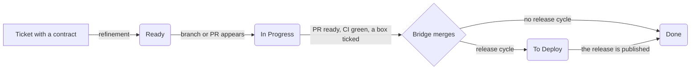

# SPL-ASDLC in ten minutes

This is the method as a person needs to know it: what happens to a ticket, what the bridge does, which layers a project can add, how a release goes, and how a person takes any step over. It is the text to read and approve. The files in `docs/spec/` are the reference behind it: the same rules with every edge case, for whoever implements or debugs the bridge. When they disagree, the spec wins and this page is fixed.

## The idea

Agents write the code. A deterministic program, **the bridge**, keeps the tracker and GitHub in step. It reads GitHub facts (branches, PRs, checks, tags, releases), moves the tickets, merges what may be merged and drives the release. CI only produces facts and never writes to the tracker. Every layer beyond the core is optional and is switched on in the project's `spl-asdlc.toml`.

## The core: every project has it

**The ticket contract.** A ticket is taken only when its description has:
- a `## Goal`;
- `## Acceptance criteria` written as checkboxes;
- a `## Business rules` section, which may say "None.".

A `## Non-goals` and a `## Release note` paragraph are recommended. A person, or a refinement agent, checks the contract (`spl-asdlc ticket check` judges it) and sets the ticket **Ready**.

**The PR.**
- One PR delivers one ticket. Its branch starts from `main` and is never stacked on another PR.
- The author ticks the boxes the PR delivers before it is reviewed or merged.
- CI must be green: the project's own checks, plus the method's PR-title and guard checks, gathered in one `required-check`.

**The bridge.** It runs every five minutes on a host the project chooses: a small machine, a cron job, a runner. At each pass, one at a time, it:
- moves the ticket to In Progress when a branch or PR appears;
- merges the PR (squash, as the GitHub App) when CI is green and every merge condition holds;
- moves the ticket to To Deploy when the project has a release cycle, or to Done when it has none.

Every write is logged, and `--dry-run` shows what a pass would do.

**Business rules.** A rule that holds for the whole product is written in `docs/business-rules.md` with the name of the test that proves it. A ticket that introduces one says so in its contract.

**Statuses.** There are eight: Triage, Backlog, Ready, In Progress, In Review, To Deploy, Post Deploy, Done, plus Canceled.
- A person writes the first three, and Canceled.
- The bridge writes the rest, from GitHub facts.
- An implementer never changes a status.

## Layers a project adds when it needs them

Each layer is one block in `spl-asdlc.toml`. Adding one needs no migration; removing one releases what it was holding.

| Layer | What it adds | How |
|---|---|---|
| **PR review** | Each PR gets a review round. One sub-ticket per review angle (security, maintainability…) is served to a reviewer agent. A consolidation item goes to a coordinator, who approves at the head. The bridge merges only after that approval. | `[[review.angles]]` |
| **Sensitive paths** | A PR touching listed files (workflows, auth, billing…) gets the security angle even when the base review is off. | `review.sensitive_paths` |
| **Release cycle** | Merged tickets wait in To Deploy for a release. The cycle is described below. | `[release]` |
| **Release QA** | Each release candidate is reviewed by angle agents on their own branches. Their fixes make a new candidate. | `[[release.angles]]` |
| **Post deploy checks** | Boxes under `## Post deploy` are verified in production after the release. An urgent validation sub-task is served to an agent, then the owner. | A section in the ticket |

The default template (`docs/setup/templates/spl-asdlc.toml`) is the core alone, with every layer shown commented out.

## The release cycle

One product has one version: a release has one tag and one CHANGELOG section. If the product is built for several platforms, its publication job builds and deploys each one.

1. **Open.** A person dispatches the cut workflow on `main` (or runs `spl-asdlc release cut --open`). It creates `release/<date>-utc`. It computes the next version from the commits since the last release (Conventional Commits: `feat` gives a minor version, `fix` a patch). It writes the version files and the CHANGELOG, then tags the first candidate, `v1.4.0-rc.1`.
2. **Gate.** The candidate's tag starts the project's test suites. A red gate opens an urgent fix ticket.
3. **QA**, if the layer is on. Angle agents review the candidate. A fix merged to the release branch makes the next candidate (rc.2), up to a limit. Past the limit, the release goes to the owner.
4. **GO.** It is computed, never declared:
   - the gate of the latest candidate is green;
   - every QA angle has merged;
   - no blocker is open;
   - nothing but the candidate's own QA reports landed after it.

   On GO, the bridge tags `v1.4.0` on the candidate and publishes the GitHub release with its CHANGELOG section.
5. **Publication.** The release starts the project's publish workflow. It checks that the release is the candidate, builds and deploys, then merges the release branch back into `main` and deletes it.
6. **Closure.** The bridge judges every ticket of the release:
   - every box ticked: **Done**;
   - only `## Post deploy` boxes left: **Post Deploy**;
   - anything else open: back to In Progress.

   It closes and archives the release issue, then sends the release note.

Work merged to `main` during a cycle simply goes into the next release.

## A person can do every step

The bridge automates; it never owns a step.

| Step | By hand |
|---|---|
| Merge a PR | Merge it in GitHub. The bridge moves the ticket at its next pass. |
| Open a cycle, cut the next candidate | Dispatch the cut workflow (`open` on `main`, `candidate` on the release branch). |
| Give the GO | Tag the candidate `vX.Y.Z` and publish the release with `gh release create`. The publication accepts it. |
| Publish when a build failed | Attach the built archives to the release, then rerun the merge-back (`replay`). |
| Keep the bridge away from something | Put the `spl-asdlc:hands-off` label on the ticket, PR or release issue. The bridge writes nothing to it until the label is removed. |
| Stop a cycle | `spl-asdlc release abandon`. |

Every command is in `docs/setup/manual-gestures.md`.

## Setting a project up

1. Install the GitHub App on the repository and set its two secrets.
2. Protect `main` with a ruleset that requires `required-check`, with the App allowed to bypass it.
3. Copy the example workflow callers (`docs/setup/examples/`): PR checks always, release workflows if the release layer is on.
4. Copy the template `spl-asdlc.toml`. The identities go in an instance file beside it, on the bridge's host, never in the repository.
5. Run the bridge on a timer, then check the setup with `spl-asdlc doctor`.

`docs/setup/README.md` has the details.

## Not there yet

- A GO given by a person's approval comment, and one more QA pass granted from the ticket. Today a person tags and publishes, or raises `max_rc_passes`.
- Products whose parts are versioned separately (multi-component).
- Trackers other than Linear and Livela.

## How the method is tested

Before each release of the bridge, a sandbox repository runs this whole page end to end against the latest build:
- a ticket, its PR, and the merge by the bridge;
- a release cycle, from the cut to the closure;
- a PR merged during the cycle, found in the next release's notes.
