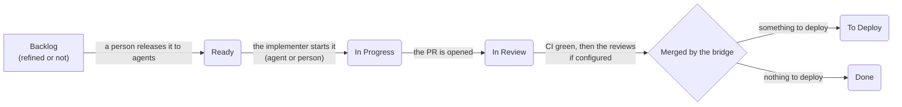
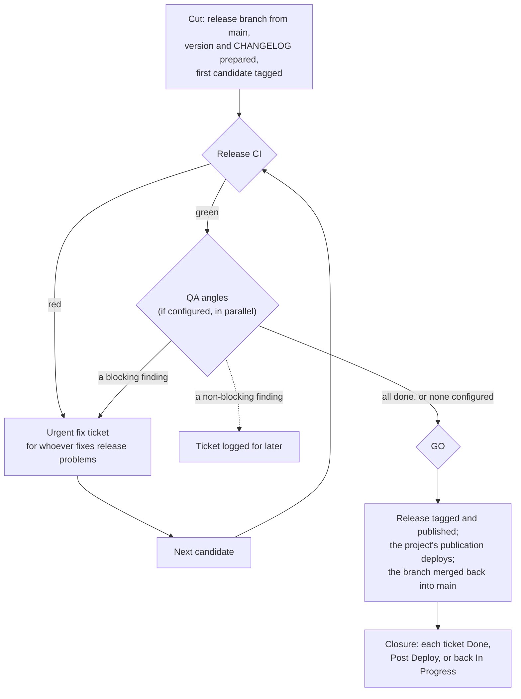

# SPL-ASDLC in ten minutes

SPL-ASDLC is a delivery method for software written by agents, with the tooling that applies it. This page is the method: what happens to a ticket, what the bridge does, how a release goes, which parts are optional and how a person takes any step over. The files in `docs/reference/` give the same rules with every detail, for whoever implements or operates the bridge; this page is authoritative when they differ.

## The idea

Agents write the code. A deterministic program, **the bridge**, keeps the tracker and GitHub in step. It reads GitHub facts (branches, PRs, checks, tags, releases) at a regular interval (Livela runs it on its own; with another tracker, a timer on a host the project chooses does), moves the tickets, merges what may be merged and drives the release. CI only produces facts and never writes to the tracker.

Everything the method needs in a repository lives in one folder, `.spl-asdlc/`:
- `config.toml`, the project's configuration;
- `business-rules/`, one file per rule;
- `qa/`, the reports of release QA.

The rest of the repository is organised as the project likes.

## From ticket to To Deploy

**Backlog.**
- A ticket starts in Backlog. Refinement turns it into a contract:
  - a `## Goal`;
  - `## Acceptance criteria` written as checkboxes;
  - a `## Business rules` section, which may say "None.".

  A `## Non-goals` and a `## Release note` paragraph are recommended.
- `spl-asdlc ticket check` judges the contract.
- A refined ticket stays in Backlog and is marked refined: a label in Linear, a dedicated state in Livela.

**Ready.** A person moves a refined ticket to Ready when it may be taken. Implementing agents take work from Ready only, so Ready is how a person controls what agents work on, and when.

**In Progress.** Whoever starts the ticket, agent or person, moves it to In Progress. With Livela, the agent's verb ("implement the next ticket") does it.

**In Review.** The ticket moves to In Review as soon as its PR is opened.
- CI runs first: the project's own checks, plus the method's PR-title and guard checks, gathered in one `required-check`.
- Once CI is green, the configured reviews start, if any (below).
- The author ticks the boxes the PR delivers.

**One PR per ticket, by default.** A ticket gets a second PR only for a real reason, typically a deployment that must happen before the rest can go on; the implementer records the reason on the ticket. Every PR stands alone: once merged, it can be deployed at any time. Its branch starts from `main` and is never stacked on another PR.

**A draft PR is out of the flow.** The bridge ignores it entirely: it moves no ticket for it, opens no review for it, never merges it, does not read its CI, and counts it for nothing among the ticket's PRs. No CI runs on a draft, so a draft costs no runner minute; marking it ready starts its CI. A person takes a PR out of the flow by putting it in draft, and back in by marking it ready; a review already open stays as it is and goes on once the PR is ready again.

**Merge.** When CI is green, the reviews are done and their fixes are in, the bridge merges the PR (squash, as the GitHub App) and says on the ticket which conditions held: green, approved when the PR had a review, up to date with `main` when the project requires it. The ticket moves to **To Deploy**: it is on `main`, waiting for the next release. A ticket with nothing to deploy, such as documentation, goes straight to **Done**; the closure of the release that ships its PR archives it with the release's tickets.

**Business rules.** A rule that holds for the whole product is one file in `.spl-asdlc/business-rules/`, with the name of the test that proves it. One file per rule means two PRs that touch different rules never conflict. A ticket that introduces a rule says so in its contract.

## PR review (optional)

Review is configured by angle: security, maintainability, design, or any angle the project defines. Each angle is reviewed by an agent or a person.
- An angle can run on every PR, or only on PRs that touch its paths. For example, a security angle runs on the workflows and the authentication code, and a design angle only on the front end.
- Each angle that applies gets a sub-ticket, served to its reviewer.
- A coordinator consolidates the findings and approves the PR. The bridge merges after that approval.

With no angle configured, a PR merges on green CI.

## The release cycle

Every project has one. It takes the tickets in To Deploy, which are already on `main`, to production.

1. **Cut.** A person dispatches the cut workflow on `main`, or runs `spl-asdlc release cut --open`. It:
   - creates `release/<date>-utc`;
   - computes the next version from the commits since the last release (Conventional Commits: `feat` gives a minor version, `fix` a patch);
   - writes the version files and the CHANGELOG;
   - tags the first candidate, for example `v1.4.0-rc.1`.

   At its next tick, the bridge opens the release issue, assigned to the owner, who decides the GO, so that no agent that takes unassigned items takes it.
2. **Release CI.** The candidate's tag runs the project's release test suites. When it is red, the bridge opens an urgent fix ticket for whoever fixes release problems. Each fix merged to the release branch makes a new candidate.
3. **QA** (optional). Once CI is green, QA starts: agents or people, several angles in parallel, each reviewing the candidate from its angle and classifying each finding as blocking or not. A blocking finding becomes an urgent fix ticket for whoever fixes release problems, as a red CI does; its fix merged to the release branch makes the next candidate. A non-blocking finding becomes a ticket logged for later. After a configured number of candidates, the release goes to the owner.
4. **GO.** It is computed, never declared:
   - the latest candidate's CI is green;
   - every QA angle is done;
   - no blocking finding is open;
   - nothing but the candidate's own QA reports landed after it.

   On GO, the bridge writes the release note into the release issue, then tags the release (`v1.4.0` in this example) on the candidate and publishes the GitHub release with its CHANGELOG section. The release note announces every PR of the release: a ticket by its `## Release note` paragraph, a PR with no ticket by its own `## Release note` section, or its title; the release's own bookkeeping (merge backs, QA reports, `chore(release)`) is left out. The bridge first writes it when the candidate's QA starts, so a GO given by hand finds it there too.
5. **Publication.** The release starts the project's publish workflow. It checks that the release is the candidate, builds and deploys every target the product has (desktop, mobile, web…), then merges the release branch back into `main`.
6. **Closure.** The bridge judges each ticket of the release:
   - every box ticked: **Done**;
   - only boxes under `## Post deploy` left, which can only be verified in production: **Post Deploy**, with an urgent validation sub-task;
   - anything else open: back to **In Progress**.

   It closes the release issue, sends the release note and archives what the cycle resolved. From then on, `spl-asdlc release status` says that no cycle is in flight and which release closed the last one.

One product has one version: one tag and one CHANGELOG section per release, whatever the number of platforms. Work merged to `main` during a cycle goes into the next release.

## A person can take any step

The bridge automates; it never owns a step.

| Step | By hand |
|---|---|
| Move a ticket | Move it in the tracker. |
| Take a PR out of the flow | Put it in draft; mark it ready to bring it back. |
| Merge a PR | Merge it in GitHub. The bridge moves the ticket at its next pass. |
| Cut a release, cut the next candidate | Dispatch the cut workflow (`open` on `main`, `candidate` on the release branch). |
| Give the GO | Tag the candidate `vX.Y.Z` and publish the release with `gh release create`. The publication accepts it. |
| Publish when a build failed | Attach the built archives to the release, then rerun the merge back (`replay`). |
| Fix a failing candidate (code, tests, CI) | Open a PR to the release branch, merge it, then cut the next candidate (`candidate` on the release branch). The merge back brings the fix to `main`. |
| Stop a cycle | `spl-asdlc release abandon`. |

Every command is in `docs/setup/manual-gestures.md`.

## Setting a project up

1. Install the GitHub App on the repository and set its two secrets.
2. Protect `main` with a ruleset that requires `required-check`, with the App allowed to bypass it.
3. Copy the example workflow callers from `docs/setup/examples/`.
4. Copy the configuration template to `.spl-asdlc/config.toml` and adapt it. The installation's identities (the repository, the tracker team, the people) go in it too, or, for a repository that must carry no names (a public one), in `.spl-asdlc/config.instance.toml` on the bridge's host only: list that file in `.gitignore`, so it is never committed.
5. Run the bridge, and check the setup with `spl-asdlc doctor`. With Livela as the tracker, Livela runs the bridge itself: there is nothing to schedule. With another tracker, run the bridge on a timer, at the interval the host chooses.

`docs/setup/README.md` has the details.

## Not there yet

- A GO given by a person's approval comment, and one more QA pass granted from the ticket. Today a person tags and publishes, or raises the configured number of candidates.
- Products whose parts are versioned separately.
- Trackers other than Linear and Livela.
